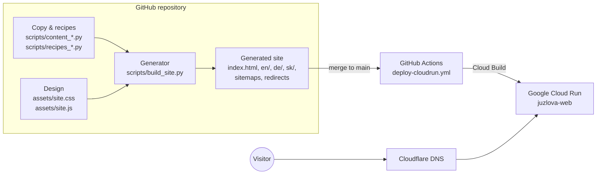
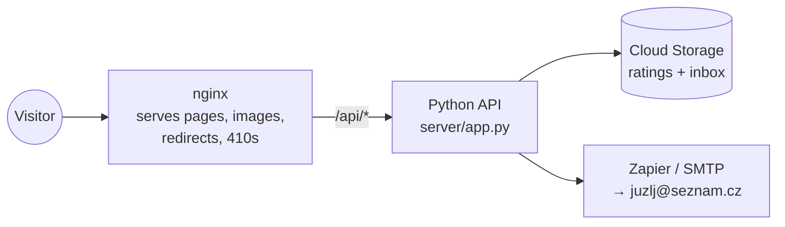
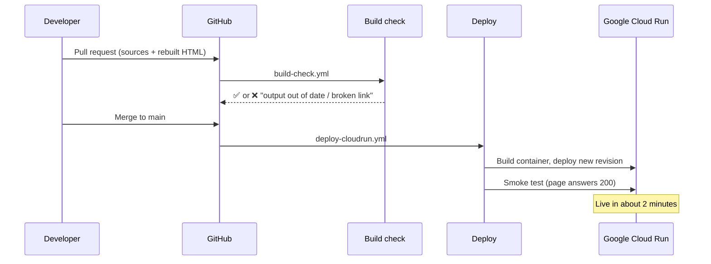

# 2. How the site is built

[← Back to the handbook](README.md)

---

## The big picture

The website is **generated**. Nobody writes HTML pages by hand. A Python
script reads the text files (one per language) and produces every page,
sitemap and redirect. The result is committed to GitHub, packed into a
container, and served by Google Cloud Run.



## Inside the running server

One container runs two programs side by side.



| Part | File | Job |
|---|---|---|
| Web server | `nginx.conf` | Serves pages with clean URLs, sets cache and security headers, applies redirects |
| Redirect rules | `redirects.conf` *(generated)* | 167 permanent redirects from old addresses, plus 410 for dead ones |
| API | `server/app.py` | `/api/contact` (contact form), `/api/ratings` (recipe star ratings), `/api/config` |
| Start-up | `server/entrypoint.sh` | Adds the analytics tag, starts the API, then starts nginx |
| Analytics tag | `server/inject-analytics.py` | Adds the Cloudflare visitor counter to every page at start-up |
| Container recipe | `Dockerfile` | nginx 1.27 on Alpine Linux, plus Python 3 |

## From a change to the live site



## Automated workflows (`.github/workflows/`)

| Workflow | Runs when | Does |
|---|---|---|
| `build-check.yml` | Every pull request and push to `main` | Rebuilds everything from scratch; fails if committed files differ or a link is broken |
| `deploy-cloudrun.yml` | Every push to `main` | **Deploys production** (`juzlova-web`) |
| `deploy-cloudrun-preview.yml` | Manual only | Deploys a test copy to `juzlova-main-preview` |
| `deploy-gcp.yml` | Manual only | Copies the site to a storage bucket (not used for the live site) |
| `cutover-pages-dns.yml` | Manual only | The single approved DNS-change script. Handle with care |
| `wayback-archive.yml` | Manual only | Re-fetches the old site from the Wayback Machine |

## The generator, briefly

`scripts/build_site.py` produces, for every language:

- every page (`index.html` in a folder per address, giving clean URLs like `/en/prices/`)
- SEO tags: title, description, canonical link, hreflang language links
- structured data for search engines (JSON-LD: Organization, Product, Recipe, FAQ, Breadcrumbs)
- `sitemap.xml` and the four language sitemaps
- `llms.txt` and `llms-full.txt`, summaries written for AI assistants
- redirect pages at old addresses, plus `redirects.conf` (nginx) and `_redirects` (Netlify)

`SITE_BASE` sets the domain used in every absolute link. It defaults to
`https://www.juzlova.cz`; change it only to build a preview copy.

## Repository layout

```
├── index.html, en/, de/, sk/   generated pages (do not edit)
├── <old-slug>/                 generated redirect pages for old addresses
├── assets/                     site.css, site.js, fonts, botanical artwork, video
├── img/                        all images used on the site
├── scripts/                    the generator, the copy, and helper tools
├── server/                     contact + ratings API, start-up scripts
├── data/                       starting data for ratings and reviews
├── ai/                         machine-readable facts for AI assistants
├── brand/                      owner's original logo files
├── archive/                    the recovered original WordPress site
├── docs/                       all documentation (you are here)
├── Dockerfile, nginx.conf      the production container
└── .github/workflows/          automation (checks and deploys)
```
