<!-- Generated by scripts/export_docs.py from the built site. Do not edit; change the sources and rebuild. -->

# Image gallery

Every file in `img/`, with its size and the pages that show it. Where each image came from is in [../05-images.md](../05-images.md).

| Preview | File | Size | Used on |
|---|---|---|---|
|  | `apple-touch-icon.png` | 6 kB | `/`, `/bebe-rezy-s-cokoladovym-pudinkem-recept/`, `/bramborove-knedliky-v-prasku/`, `/caste-dotazy/` +112 more |
| 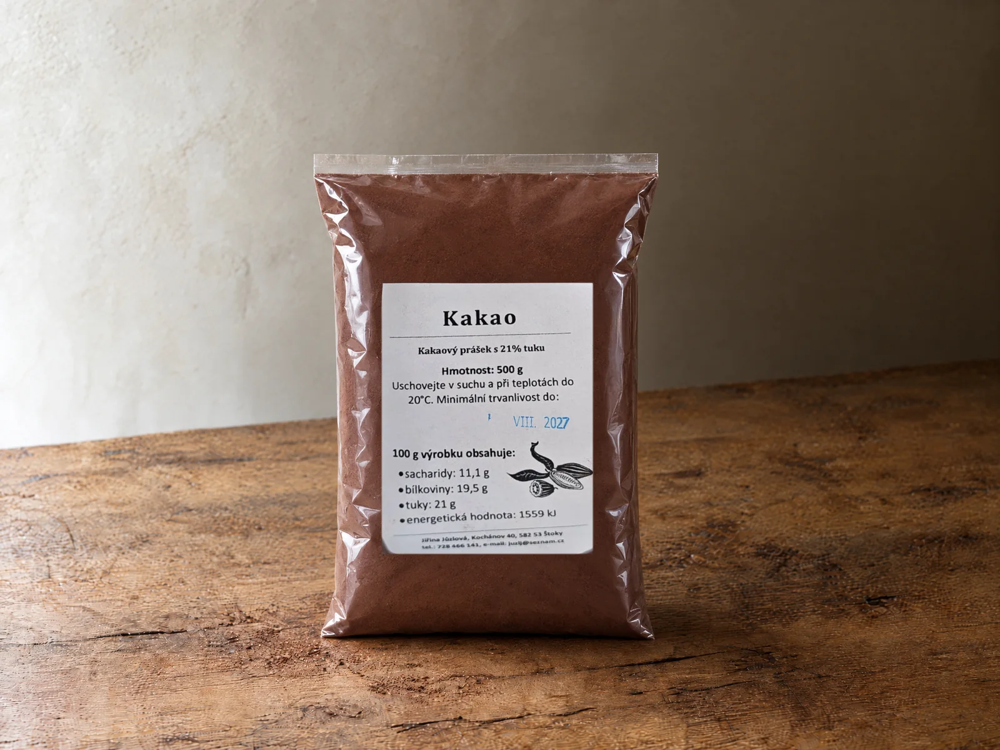 | `baleni-kakao_holandskeho_typu.webp` | 189 kB | `/de/kakaopulver-hollaendischer-art/`, `/en/dutch-process-cocoa-powder/`, `/kakao-holandskeho-typu/`, `/sk/kakao-holandskeho-typu/` |
| 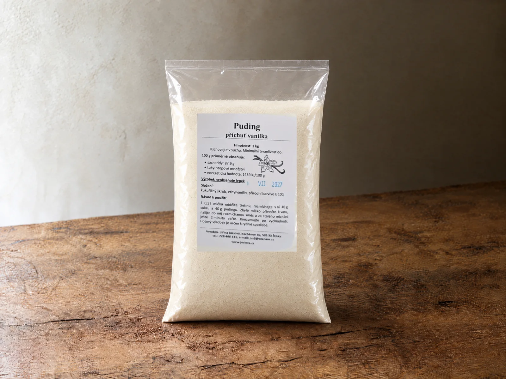 | `baleni-vanilkovy_pudink.webp` | 194 kB | `/de/glutenfreies-vanillepuddingpulver/`, `/en/gluten-free-vanilla-pudding-powder/`, `/sk/vanilkovy-puding-bez-lepku/`, `/vanilkovy-puding-bez-lepku/` |
| 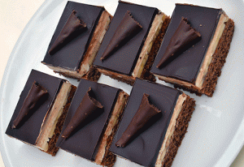 | `bebe-rezy.gif` | 41 kB | not referenced by the current site (source, original or spare size) |
| 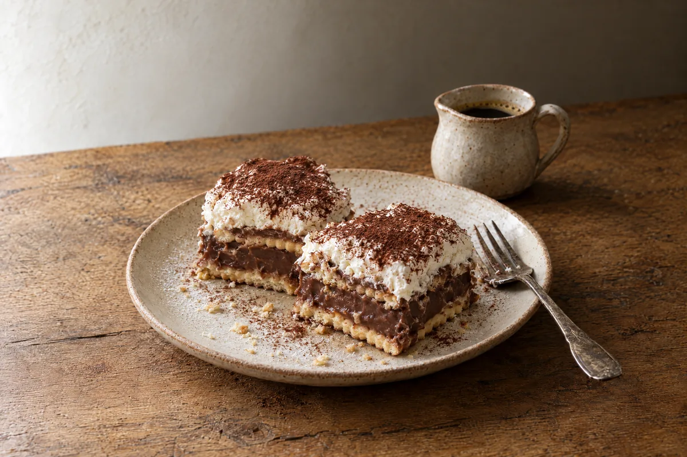 | `bebe-rezy.webp` | 145 kB | `/bebe-rezy-s-cokoladovym-pudinkem-recept/`, `/de/birnenkuchen-mit-vanillepudding/`, `/de/keksschnitten-mit-schokopudding/`, `/de/mohnnudeln-aus-kartoffelteig/` +32 more |
| 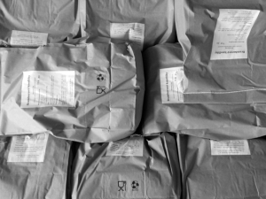 | `bramborove-knedliky.png` | 61 kB | not referenced by the current site (source, original or spare size) |
| 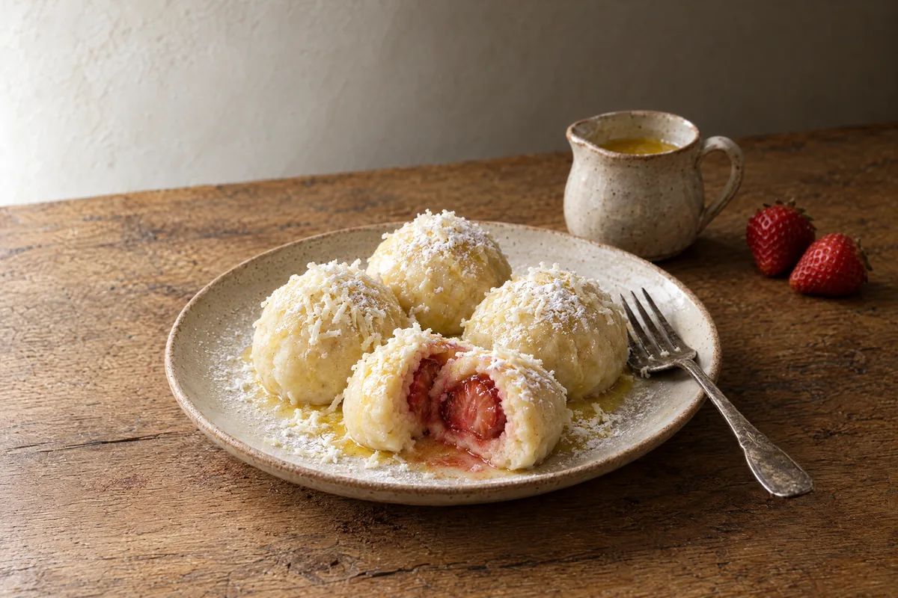 | `bramborovo-tvarohove-knedliky.webp` | 130 kB | `/de/mohnnudeln-aus-kartoffelteig/`, `/de/rezepte/`, `/de/strapacky-mit-kraut-und-speck/`, `/de/topfenknoedel-mit-erdbeeren/` +12 more |
| 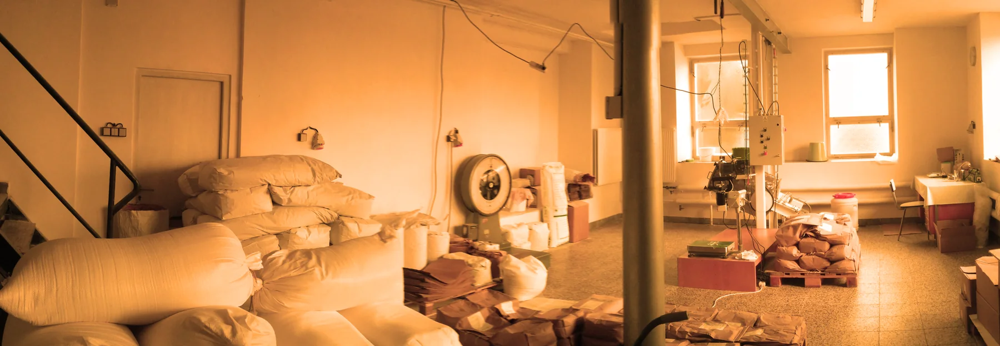 | `dilna-panorama.webp` | 101 kB | `/`, `/bebe-rezy-s-cokoladovym-pudinkem-recept/`, `/bramborove-knedliky-v-prasku/`, `/caste-dotazy/` +112 more |
| 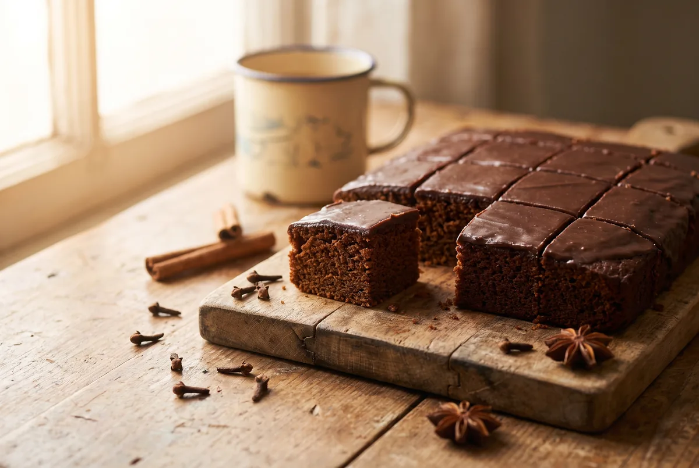 | `domaci-pernik.webp` | 83 kB | `/bebe-rezy-s-cokoladovym-pudinkem-recept/`, `/de/birnenkuchen-mit-vanillepudding/`, `/de/brandteigkraenze-mit-vanillecreme/`, `/de/karamell-windbeutel/` +48 more |
|  | `favicon.ico` | 3 kB | `/`, `/bebe-rezy-s-cokoladovym-pudinkem-recept/`, `/bramborove-knedliky-v-prasku/`, `/caste-dotazy/` +112 more |
| 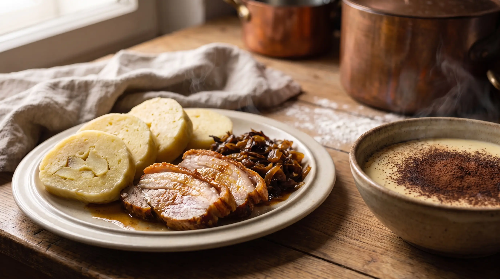 | `film-blizko.webp` | 198 kB | not referenced by the current site (source, original or spare size) |
| 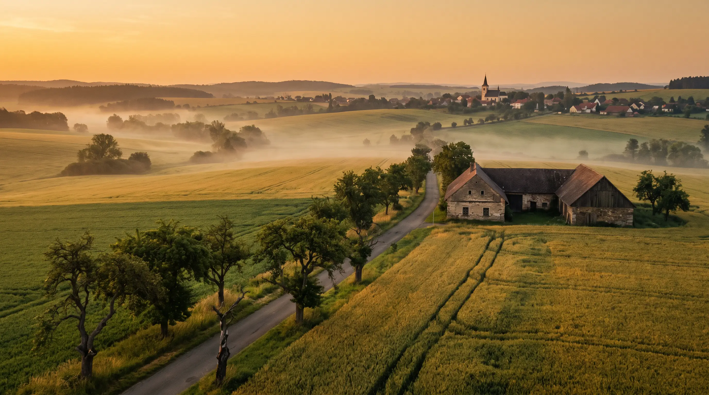 | `film-krajina.webp` | 423 kB | not referenced by the current site (source, original or spare size) |
| 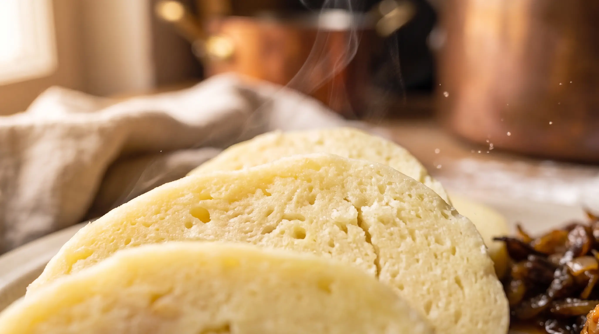 | `film-makro.webp` | 89 kB | not referenced by the current site (source, original or spare size) |
| 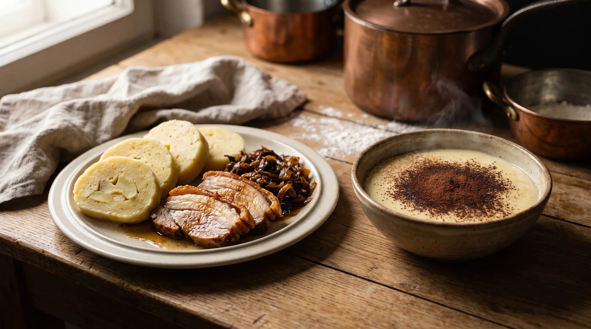 | `hero.webp` | 222 kB | `/`, `/caste-dotazy/`, `/cenik/`, `/de/` +36 more |
|  | `hruskovy-kolac-640.webp` | 28 kB | `/`, `/de/`, `/en/`, `/sk/` |
| 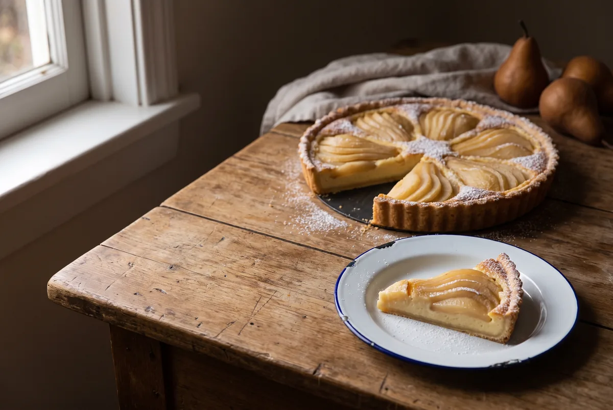 | `hruskovy-kolac.webp` | 79 kB | `/`, `/bebe-rezy-s-cokoladovym-pudinkem-recept/`, `/de/`, `/de/birnenkuchen-mit-vanillepudding/` +52 more |
|  | `icon-192.png` | 9 kB | `/`, `/bebe-rezy-s-cokoladovym-pudinkem-recept/`, `/bramborove-knedliky-v-prasku/`, `/caste-dotazy/` +113 more |
|  | `icon-32.png` | 1 kB | `/`, `/bebe-rezy-s-cokoladovym-pudinkem-recept/`, `/bramborove-knedliky-v-prasku/`, `/caste-dotazy/` +112 more |
|  | `icon-512.png` | 27 kB | `/`, `/bebe-rezy-s-cokoladovym-pudinkem-recept/`, `/bramborove-knedliky-v-prasku/`, `/caste-dotazy/` +113 more |
|  | `icon-white-192.png` | 9 kB | not referenced by the current site (source, original or spare size) |
|  | `icon-white-32.png` | 1 kB | `/`, `/bebe-rezy-s-cokoladovym-pudinkem-recept/`, `/bramborove-knedliky-v-prasku/`, `/caste-dotazy/` +112 more |
|  | `icon-white-512.png` | 26 kB | not referenced by the current site (source, original or spare size) |
| 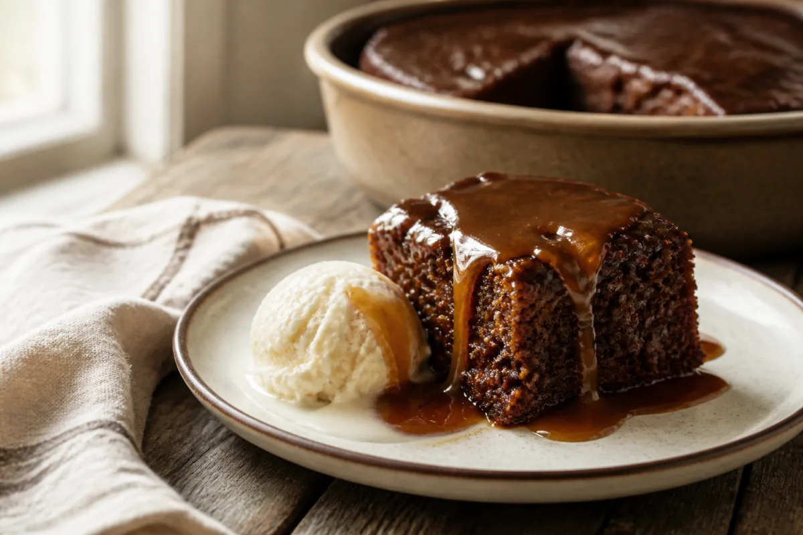 | `irsky-sticky-toffee-pudding.webp` | 76 kB | `/bebe-rezy-s-cokoladovym-pudinkem-recept/`, `/de/keksschnitten-mit-schokopudding/`, `/de/rezepte/`, `/de/sahnerolle/` +12 more |
| 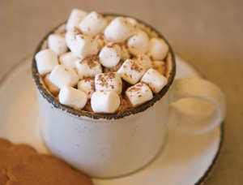 | `kakao.jpg` | 44 kB | not referenced by the current site (source, original or spare size) |
| 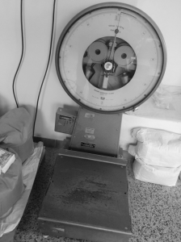 | `kakaovy-puding.png` | 51 kB | not referenced by the current site (source, original or spare size) |
| 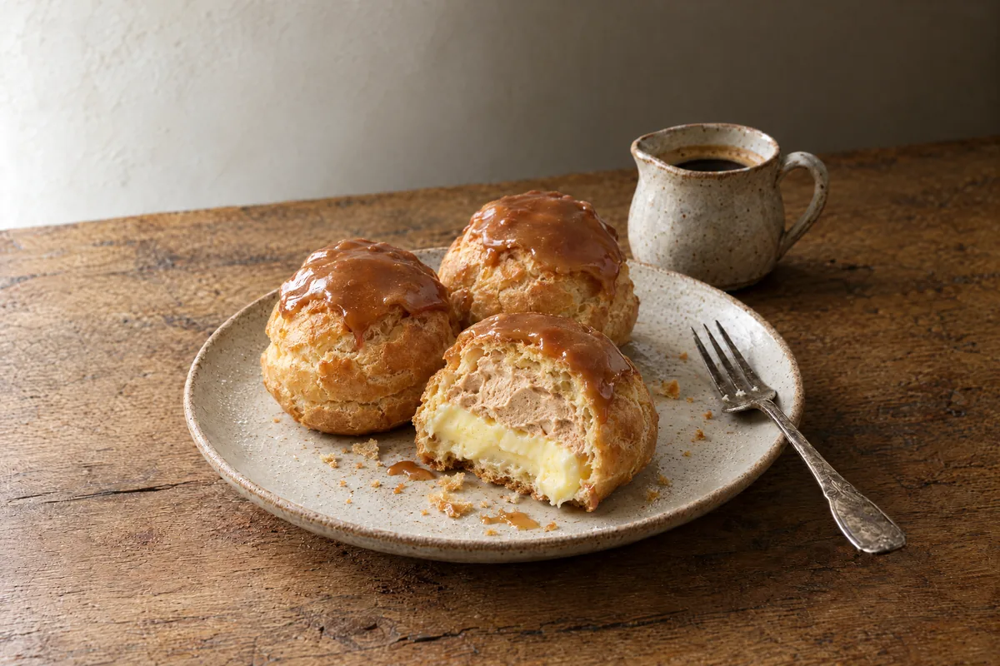 | `karamelove-vetrniky.webp` | 133 kB | `/de/birnenkuchen-mit-vanillepudding/`, `/de/brandteigkraenze-mit-vanillecreme/`, `/de/karamell-windbeutel/`, `/de/mini-windbeutel/` +32 more |
| 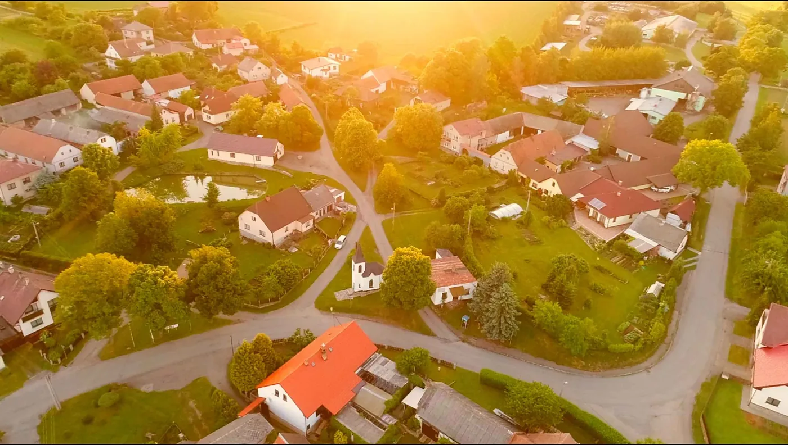 | `kochanov-letecky-1400.webp` | 135 kB | not referenced by the current site (source, original or spare size) |
|  | `kochanov-letecky-900.webp` | 75 kB | not referenced by the current site (source, original or spare size) |
|  | `kochanov-letecky-960.webp` | 57 kB | not referenced by the current site (source, original or spare size) |
|  | `kochanov-letecky.webp` | 280 kB | not referenced by the current site (source, original or spare size) |
| 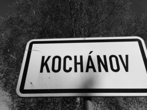 | `kochanov.png` | 50 kB | not referenced by the current site (source, original or spare size) |
| 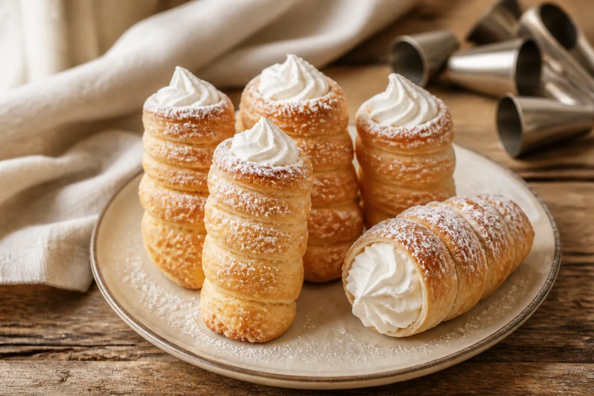 | `kremrole.webp` | 112 kB | `/de/rezepte/`, `/de/schaumrollen/`, `/de/schnelle-brandteigkraenze/`, `/en/cream-horns/` +8 more |
|  | `logo-wordmark-black.png` | 21 kB | `/`, `/bebe-rezy-s-cokoladovym-pudinkem-recept/`, `/bramborove-knedliky-v-prasku/`, `/caste-dotazy/` +112 more |
|  | `logo-wordmark-white.png` | 25 kB | not referenced by the current site (source, original or spare size) |
|  | `logo.png` | 2 kB | not referenced by the current site (source, original or spare size) |
|  | `mark-white.png` | 33 kB | not referenced by the current site (source, original or spare size) |
| 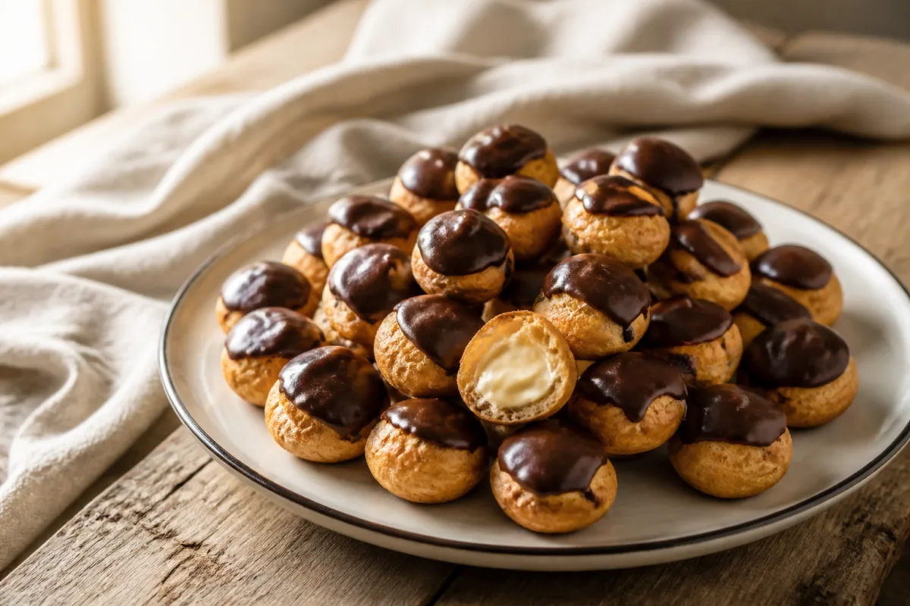 | `minivetrnicky.webp` | 94 kB | `/de/birnenkuchen-mit-vanillepudding/`, `/de/brandteigkraenze-mit-vanillecreme/`, `/de/karamell-windbeutel/`, `/de/mini-windbeutel/` +32 more |
| 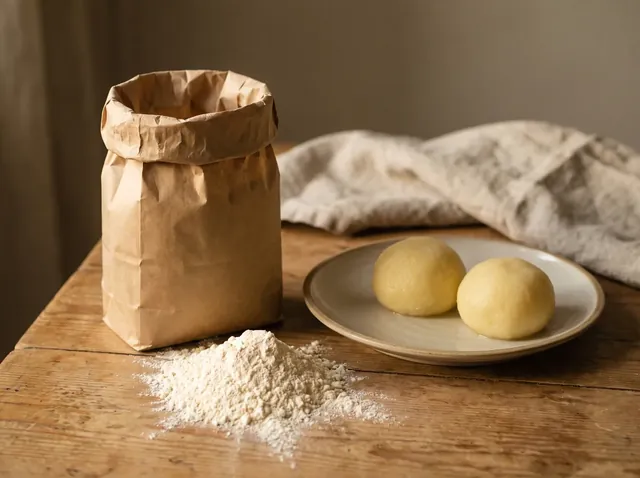 | `produkt-bramborove-knedliky-640.webp` | 42 kB | `/`, `/bramborove-knedliky-v-prasku/`, `/de/`, `/de/kartoffelknoedel-mischung/` +4 more |
| 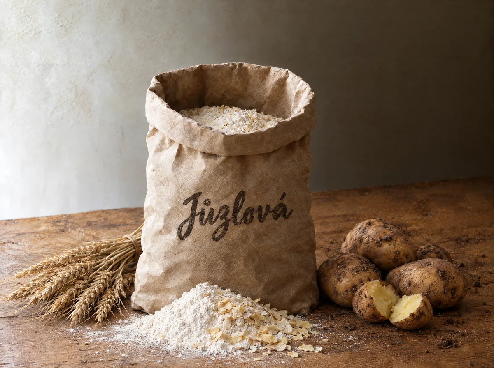 | `produkt-bramborove-knedliky.webp` | 148 kB | `/`, `/bramborove-knedliky-v-prasku/`, `/de/`, `/de/kartoffelknoedel-mischung/` +4 more |
| 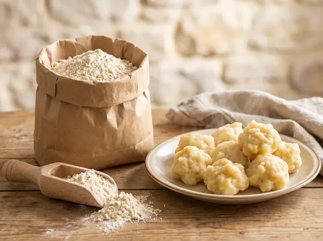 | `produkt-chlupate-knedliky-640.webp` | 42 kB | `/`, `/chlupate-knedliky-v-prasku/`, `/de/`, `/de/rohe-kartoffelknoedel-mischung/` +4 more |
| 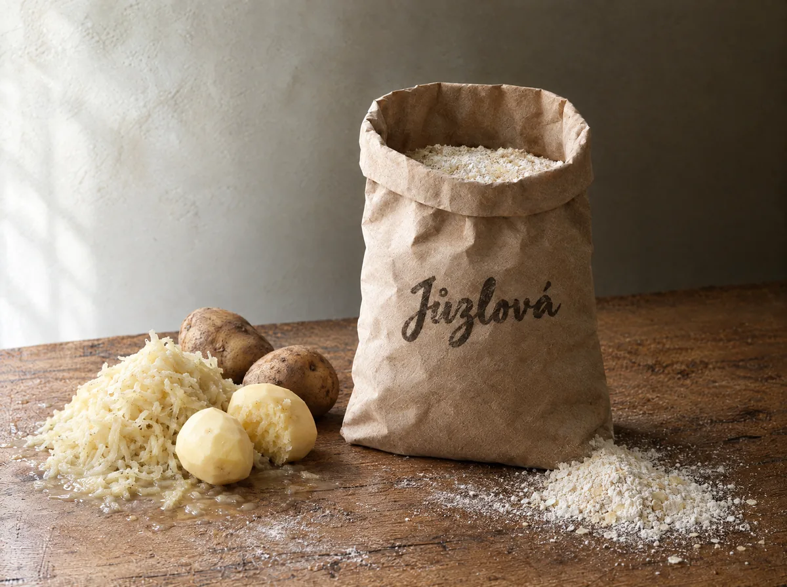 | `produkt-chlupate-knedliky.webp` | 147 kB | `/`, `/chlupate-knedliky-v-prasku/`, `/de/`, `/de/rohe-kartoffelknoedel-mischung/` +4 more |
| 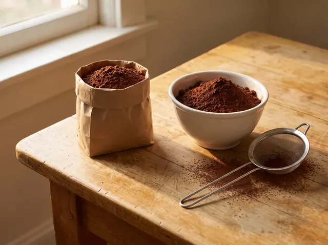 | `produkt-kakao-640.webp` | 41 kB | `/`, `/de/`, `/de/kakaopulver-hollaendischer-art/`, `/en/` +4 more |
| 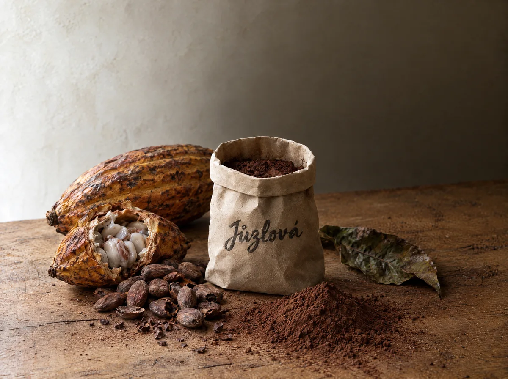 | `produkt-kakao.webp` | 135 kB | `/`, `/de/`, `/de/kakaopulver-hollaendischer-art/`, `/en/` +4 more |
|  | `produkt-vanilkovy-puding-640.webp` | 42 kB | `/`, `/de/`, `/de/glutenfreies-vanillepuddingpulver/`, `/en/` +4 more |
| 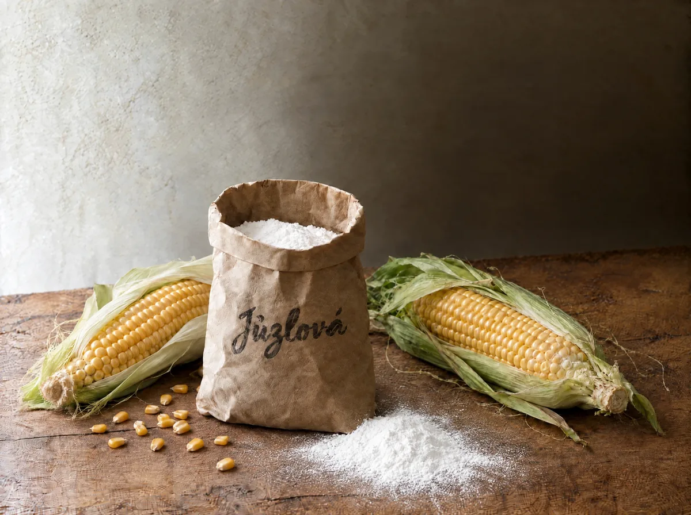 | `produkt-vanilkovy-puding.webp` | 131 kB | `/`, `/de/`, `/de/glutenfreies-vanillepuddingpulver/`, `/en/` +4 more |
| 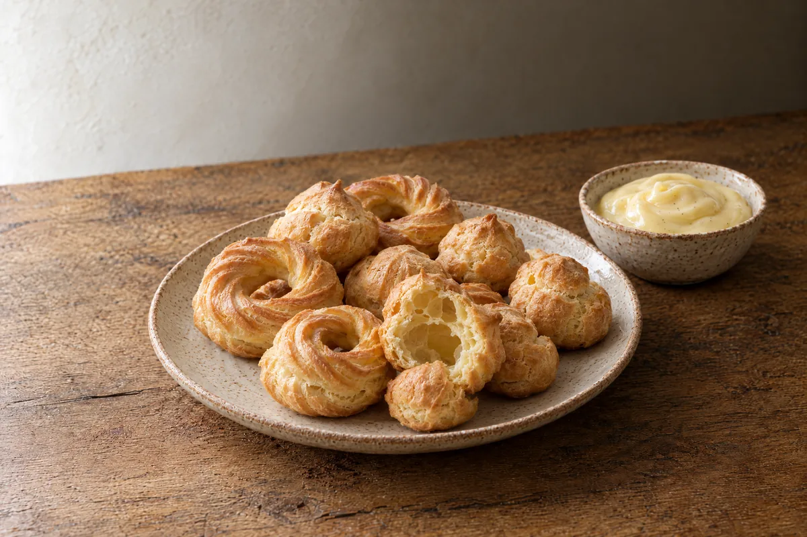 | `rychle-venecky-vetrnicky.webp` | 132 kB | `/de/brandteigkraenze-mit-vanillecreme/`, `/de/karamell-windbeutel/`, `/de/mini-windbeutel/`, `/de/rezepte/` +24 more |
|  | `sisky-s-makem-640.webp` | 31 kB | `/`, `/de/`, `/en/`, `/sk/` |
| 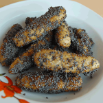 | `sisky-s-makem.png` | 44 kB | not referenced by the current site (source, original or spare size) |
| 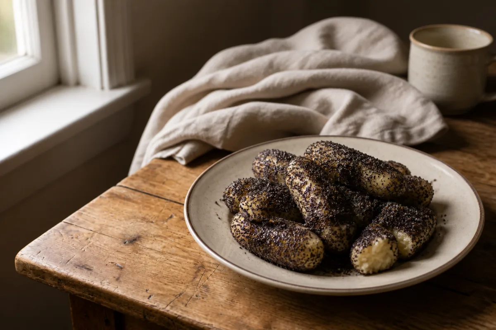 | `sisky-s-makem.webp` | 85 kB | `/`, `/bebe-rezy-s-cokoladovym-pudinkem-recept/`, `/de/`, `/de/keksschnitten-mit-schokopudding/` +36 more |
| 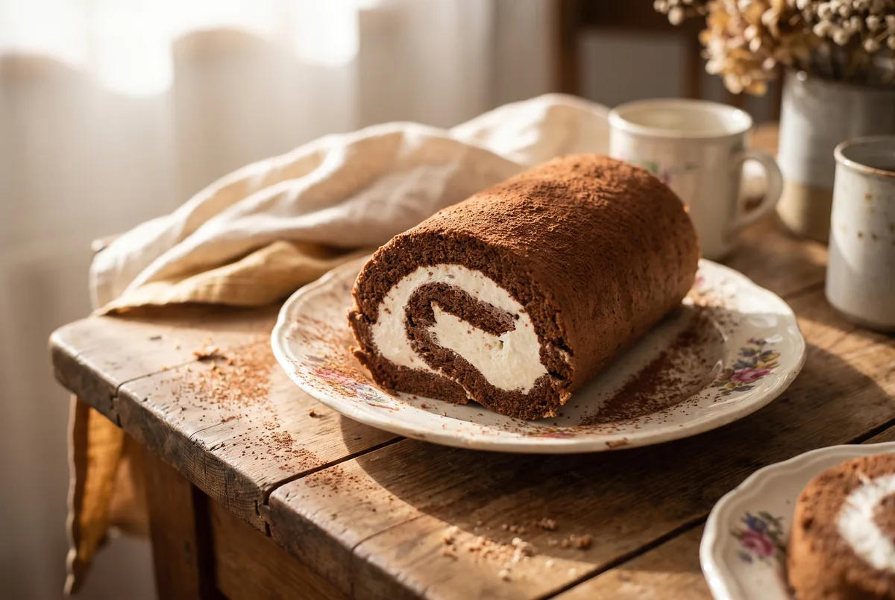 | `slehackova-rolada.webp` | 87 kB | `/bebe-rezy-s-cokoladovym-pudinkem-recept/`, `/de/keksschnitten-mit-schokopudding/`, `/de/mohnnudeln-aus-kartoffelteig/`, `/de/rezepte/` +24 more |
| 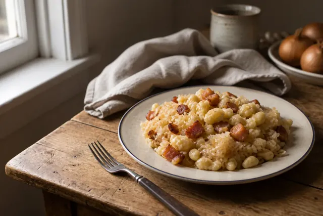 | `strapacky-640.webp` | 28 kB | `/`, `/de/`, `/en/`, `/sk/` |
| 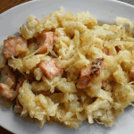 | `strapacky.jpg` | 58 kB | not referenced by the current site (source, original or spare size) |
|  | `strapacky.webp` | 80 kB | `/`, `/bebe-rezy-s-cokoladovym-pudinkem-recept/`, `/de/`, `/de/keksschnitten-mit-schokopudding/` +28 more |
| 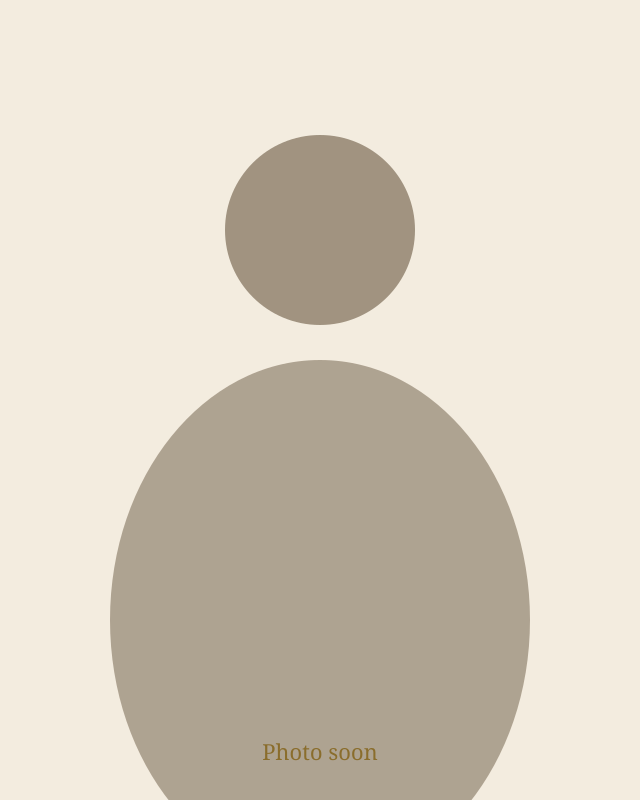 | `team/adam-kennedy.svg` | 0 kB | `/de/ueber-uns/`, `/en/about-us/`, `/kdo-jsme/`, `/sk/kto-sme/` |
| 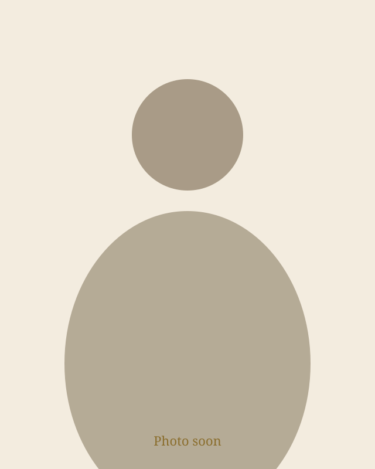 | `team/filip-kuzel.svg` | 0 kB | `/de/ueber-uns/`, `/en/about-us/`, `/kdo-jsme/`, `/sk/kto-sme/` |
| 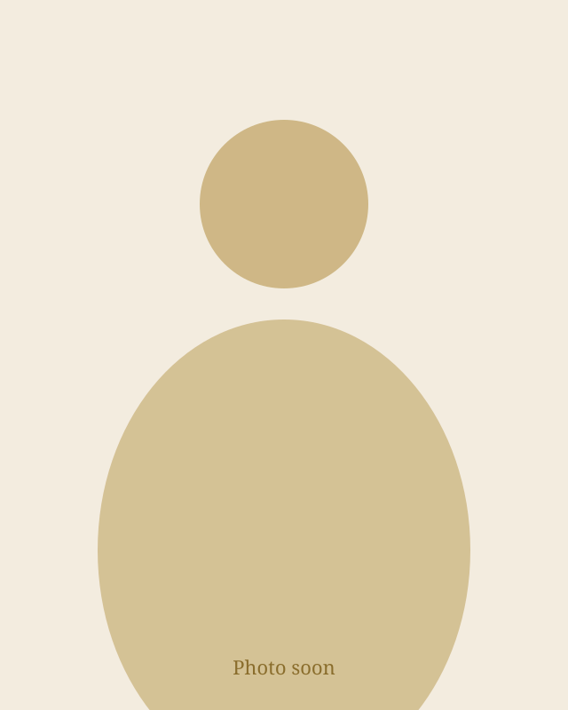 | `team/jira-kennedy-juzlova.svg` | 0 kB | `/de/ueber-uns/`, `/en/about-us/`, `/kdo-jsme/`, `/sk/kto-sme/` |
| 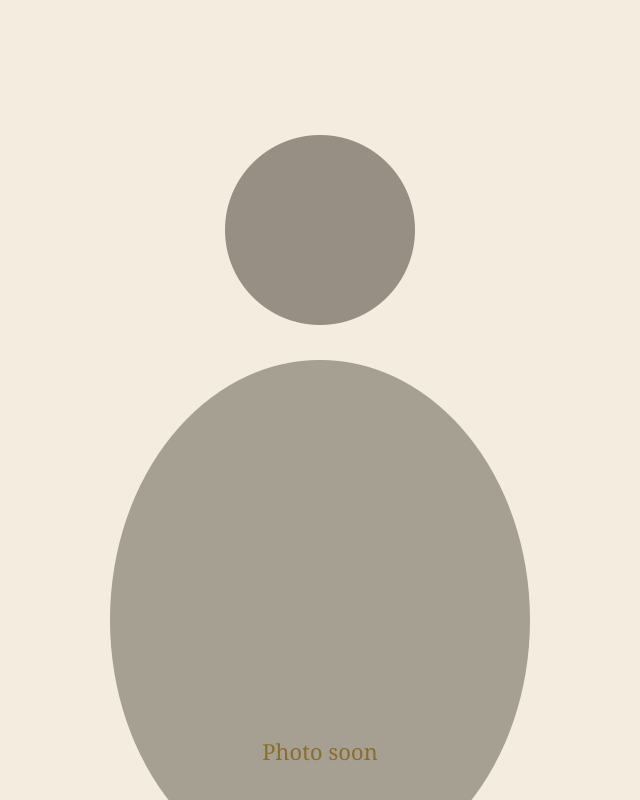 | `team/jiri-juzl.svg` | 0 kB | `/de/ueber-uns/`, `/en/about-us/`, `/kdo-jsme/`, `/sk/kto-sme/` |
|  | `team/jirina-juzlova.webp` | 26 kB | `/de/ueber-uns/`, `/en/about-us/`, `/kdo-jsme/`, `/sk/kto-sme/` |
| 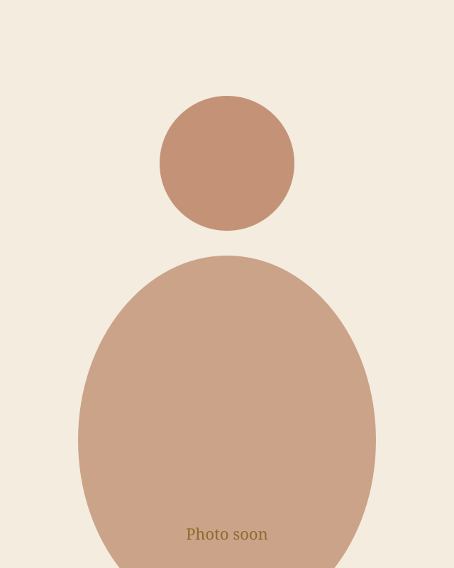 | `team/lucie-kuzelova.svg` | 0 kB | `/de/ueber-uns/`, `/en/about-us/`, `/kdo-jsme/`, `/sk/kto-sme/` |
|  | `vanilkovy-cukr-kilo-640.webp` | 42 kB | `/`, `/de/`, `/de/vanillinzucker/`, `/en/` +4 more |
| 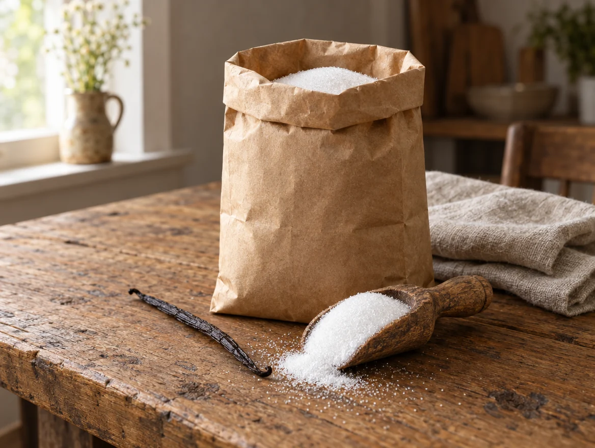 | `vanilkovy-cukr-kilo.webp` | 109 kB | `/`, `/de/`, `/de/vanillinzucker/`, `/en/` +4 more |
| 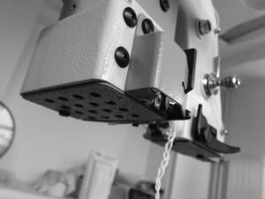 | `vanilkovy-puding.png` | 52 kB | not referenced by the current site (source, original or spare size) |
| 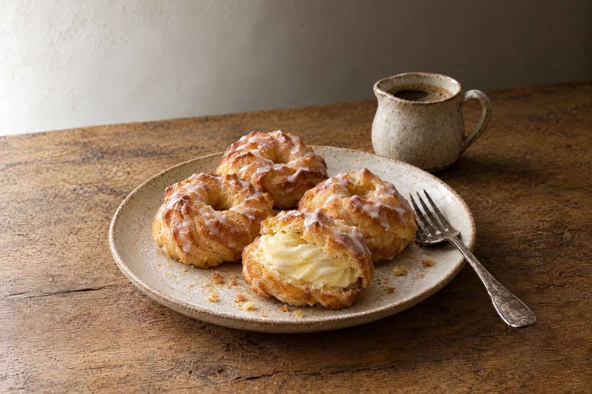 | `venecky-s-vanilkovym-kremem.webp` | 132 kB | `/de/birnenkuchen-mit-vanillepudding/`, `/de/brandteigkraenze-mit-vanillecreme/`, `/de/karamell-windbeutel/`, `/de/mini-windbeutel/` +32 more |
| 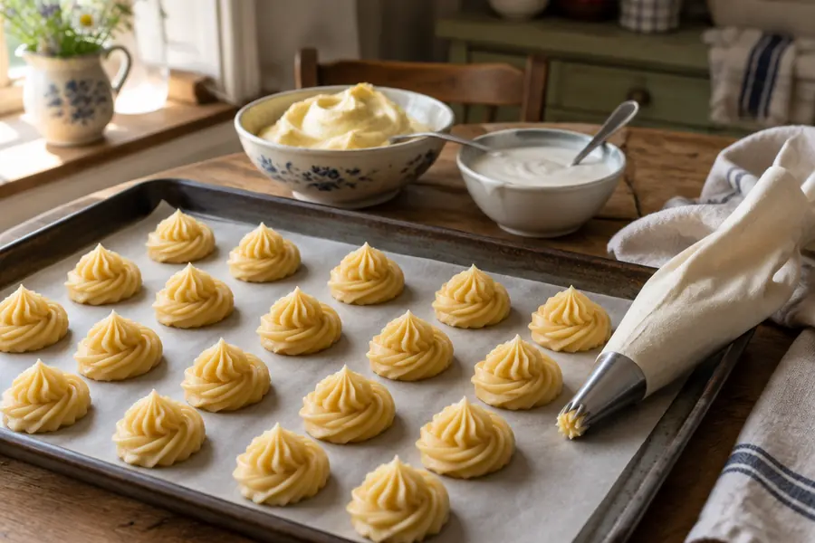 | `vetrnicky-s-vanilkovym-kremem-postup.webp` | 46 kB | `/de/windbeutel-mit-vanillecreme/`, `/en/cream-puffs-with-vanilla-cream/`, `/sk/veterniky-s-vanilkovym-kremom/`, `/vetrnicky-s-vanilkovym-kremem-recept/` |
| 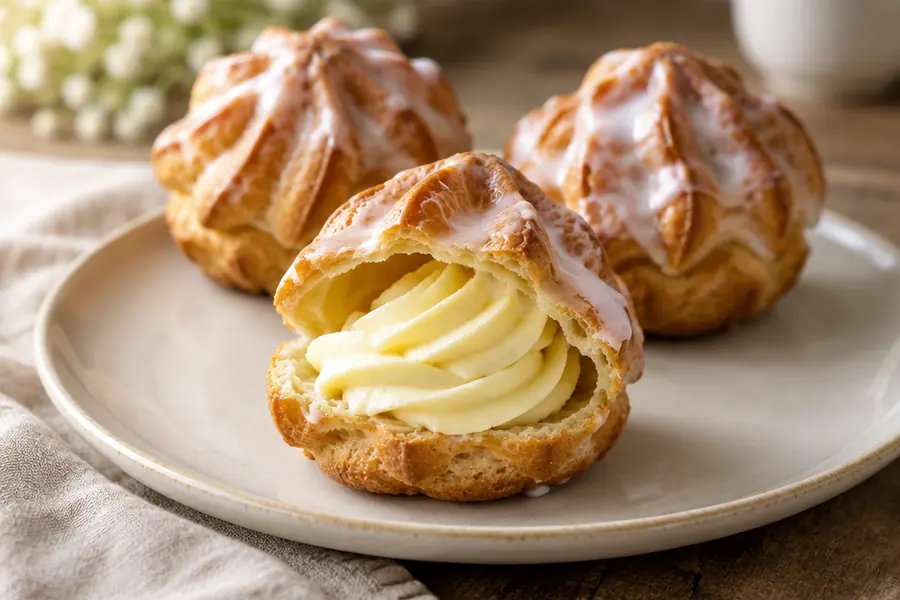 | `vetrnicky-s-vanilkovym-kremem-rez.webp` | 41 kB | `/de/windbeutel-mit-vanillecreme/`, `/en/cream-puffs-with-vanilla-cream/`, `/sk/veterniky-s-vanilkovym-kremom/`, `/vetrnicky-s-vanilkovym-kremem-recept/` |
| 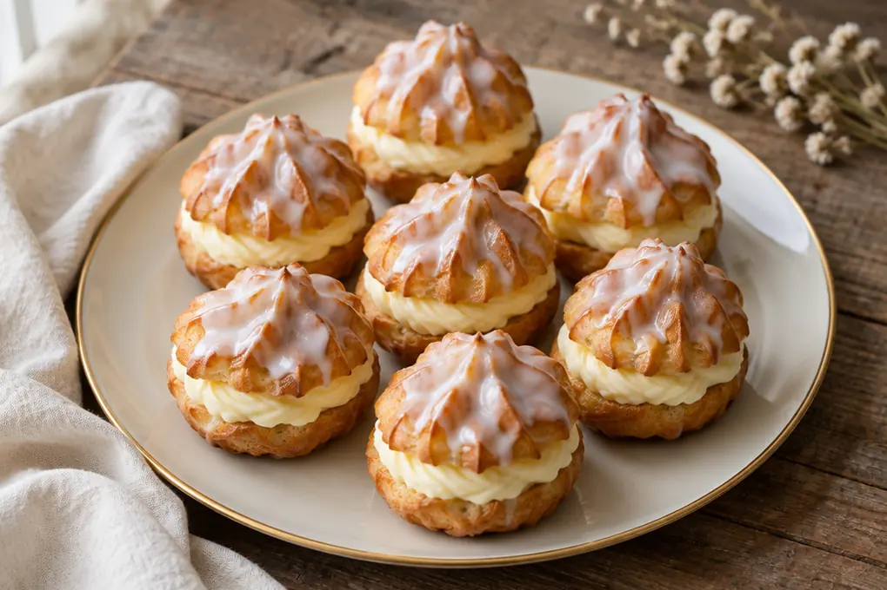 | `vetrnicky-s-vanilkovym-kremem.webp` | 61 kB | `/de/birnenkuchen-mit-vanillepudding/`, `/de/brandteigkraenze-mit-vanillecreme/`, `/de/karamell-windbeutel/`, `/de/mini-windbeutel/` +32 more |
| 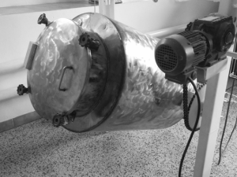 | `vyroba.png` | 58 kB | not referenced by the current site (source, original or spare size) |
| 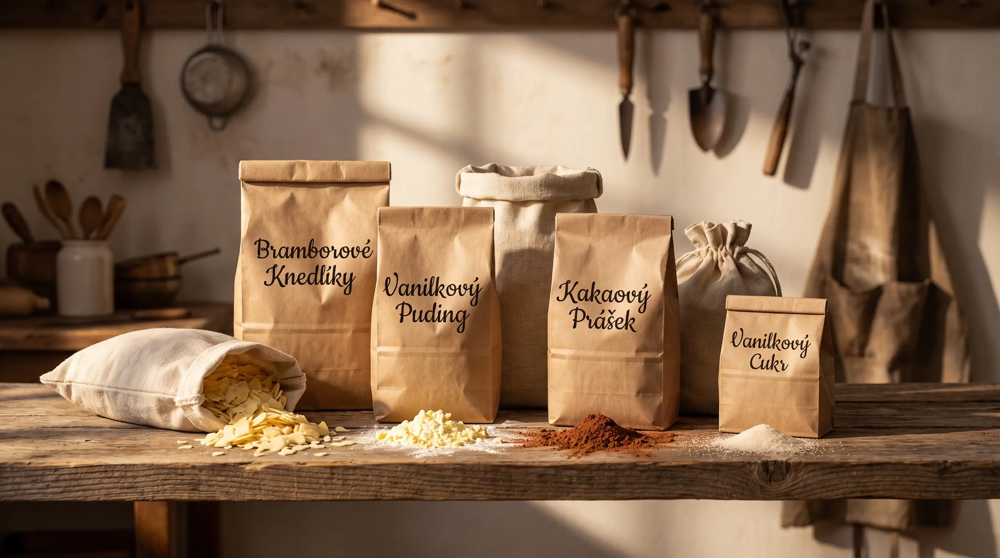 | `workshop.webp` | 226 kB | not referenced by the current site (source, original or spare size) |

**Total:** 5.2 MB in `img/`.
